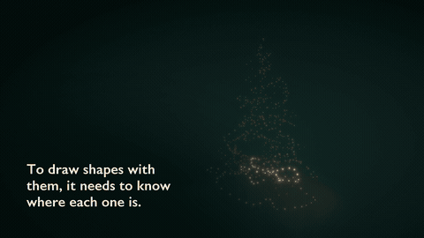

# How to calibrate the tree

Calibrating teaches the tree where each of its 500 lights is in 3D, so effects like a sweeping plane or a spiral can follow the shape of the tree. It takes about ten minutes, one phone, and a dark room.



▶ The full 70-second explainer video (no sound, everything is captioned): [calibrate-the-tree.mp4](img/calibration/calibrate-the-tree.mp4).

## What the button does

In Home Assistant, on the Christmas tree's page, press **Play calibration sequence**. Then:

1. **The tree goes dark for about 6 seconds.**
2. **It starts blinking in a fast, flickery pattern**, which repeats every 6.6 seconds. Each round starts with a second of darkness and a burst of quick whole-tree flashes.
3. **It keeps repeating for up to 5 minutes** after you pressed the button.
4. **Then it goes back to whatever it was showing before.**

While it's running, the tree's **Calibrating** sensor (in the Diagnostic section of its page) says **On**. If the tree doesn't go dark, or Calibrating stays Off, stop and tell whoever looks after the tree.

Pressing the button again while it's still blinking does nothing. If the 5 minutes run out before you're done, wait for the tree to go back to normal, then press it again. **Stop calibration** ends it early.

## Before you start

- **Use one phone for every clip.** Don't swap phones halfway.
- **Make the room dark.** Room lights off, curtains closed, lamps and screens off or out of shot. Darker is better, but you need just enough light to walk safely.
- **Set the camera to normal video at 1080p, 30 fps.** On an iPhone, tap the "4K" or "HD" label at the top of the camera screen until it says HD · 30. Don't use Cinematic, Slo-mo, Time-lapse, Action or Night mode.
- **iPhone only: turn off HDR video.** It's in Settings → Camera → Record Video → HDR Video.
- **Hold the phone upright** (portrait), so the whole tree fits.
- **Pick the "front"** of the tree: the side people usually look at. Effects treat that side as the front.

## Step by step

1. **Choose 4 to 6 spots** spread evenly around the tree, about 2 metres away. Start with the front, then go round in order. More spots help the lights at the back.
2. At the front spot, **frame the whole tree**, from the top of the topper to the bottom branches, with a little space around it.
3. **Press Play calibration sequence.** Wait for the tree to go dark and then start blinking.
4. **Start recording and hold still for about 12 seconds** (count slowly to 12). Lean on a wall or a chair back, or use a tripod. Small wobbles are fine; walking isn't.
5. **Stop recording**, walk to the next spot, and repeat steps 2 and 4. The tree keeps blinking, so there's no need to press the button again.
6. When you've done every spot, you're finished. The tree returns to normal by itself, or press **Stop calibration**.

Six spots take about 3 minutes, well inside the 5-minute window.

## Please don't

- **Zoom, or switch lenses** (0.5×, 2× and so on). Stay on the normal 1× lens for every clip.
- **Walk while recording.** Stop, move, then record.
- **Stand so close** that the top or bottom of the tree is cut off.
- **Film with the room lights on**, or with the phone's torch on.
- **Start recording before the tree starts blinking.** Press the button first, wait for the blinking, then record.

## Send the clips

**AirDrop the clips to the Mac** of whoever runs the computer side, or copy them over a cable. **Don't send them through WhatsApp, Messages or email**: those shrink the video, and the decoder needs the originals.

It helps to name them in the order you filmed, front first: `1-front`, `2`, `3`, and so on.

> **Why does this work?**
>
> Every light blinks its own number, as a pattern of on and off, followed by the exact opposite. Comparing each pair tells the decoder "on" from "off" even when the camera's brightness changes. The pattern includes error correction, so a light that's misread is rejected rather than mistaken for another light.
>
> In each clip, the decoder works out which light is where on the screen. A single view only gives a direction from the phone to each light. Several views from different spots cross at each light, and that pins it down in 3D. The decoder also works out where each phone spot was, and the camera's lens, from the lights themselves.

## For whoever runs the computer bit

This needs the tree repository on branch `calibration/video-pipeline` (or `main` once #22 is merged), with [uv](https://docs.astral.sh/uv/) installed. Put the clips in a folder, for example `~/Desktop/tree-clips`, named so the front clip sorts first.

**Before anyone films, check the tree has the calibration sequence.** If it doesn't, the button does nothing.

```bash
curl -s http://tree.local:8080/calibrate
```

`"default"` under `"sequences"` must not be `null`; with the current sequence it shows `"crc32": "83cffe28"`. If it is `null`, the firmware needs a build from #21 that bundles `sequences/default.tcal`, which is a firmware update.

```bash
# 1. Find the LEDs in each clip (under a minute per clip)
./calibrate.py decode-video ~/Desktop/tree-clips/* --out positions/tonight

# 2. Combine the views into 3D (front clip first, which the name order handles)
./calibrate.py solve positions/tonight/*_detections.json --out coordinates

# 3. Optional: check for wire-continuity problems (assumes a 1.75 m light span and 10 cm spacing)
./calibrate.py quality coordinates/coords.txt --height-m 1.75 --pitch 0.10

# 4. Install it (needs the tree's HTTP token, as for flash.py)
curl -X PUT --data-binary @coordinates/coords.txt \
  -H "Authorization: Bearer $TREE_TOKEN" http://tree.local:8080/files/coords.txt
```

**What to look for.**

- **Step 1** prints "N/500 confident detections" per clip. A few hundred per clip is normal; lights behind the tree can't be seen from every side.
- **Step 2** prints a median reprojection error. A few pixels means the views agree. Much more than about 8 px means something went wrong, usually a zoomed or moving clip. Leave that clip out and run it again.
- **Step 2** also fills in LEDs seen in fewer than two clips along the wire, and marks them with low confidence in `coordinates/coords_metres.csv`.
- **Step 4** takes effect straight away; `coords.txt` takes precedence over any old `coords_compact.txt`.

**This is the first run on real phone footage.** The decoder has only been tested on simulated phone video ([docs/calibration-findings.md](calibration-findings.md)). If the numbers look off, keep the clips and the `positions/tonight` folder, so the run can be checked.
