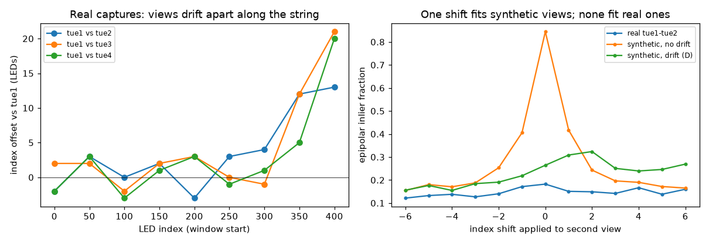
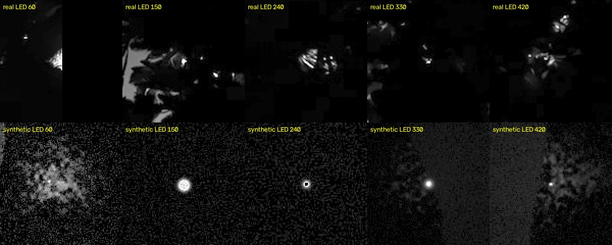
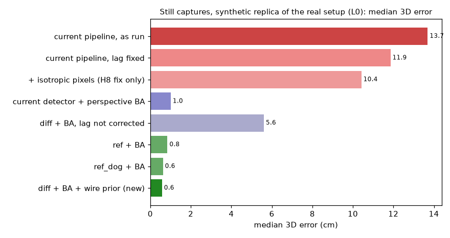
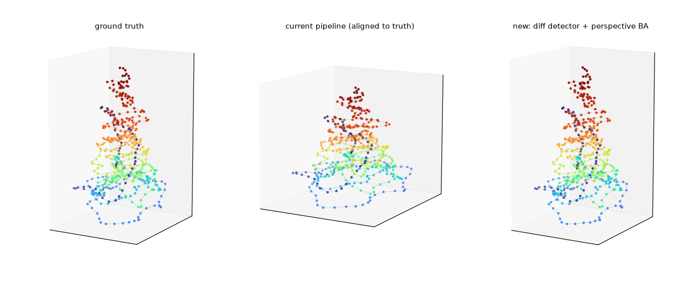
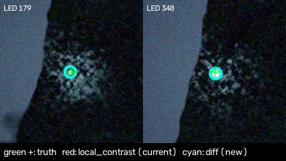
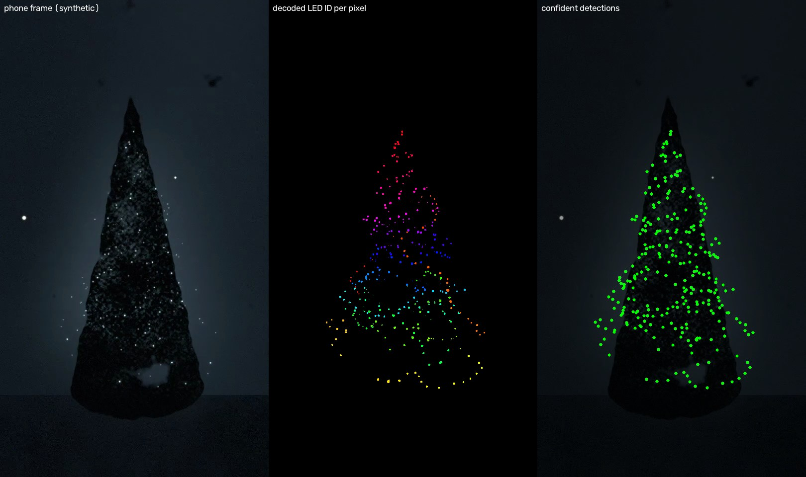
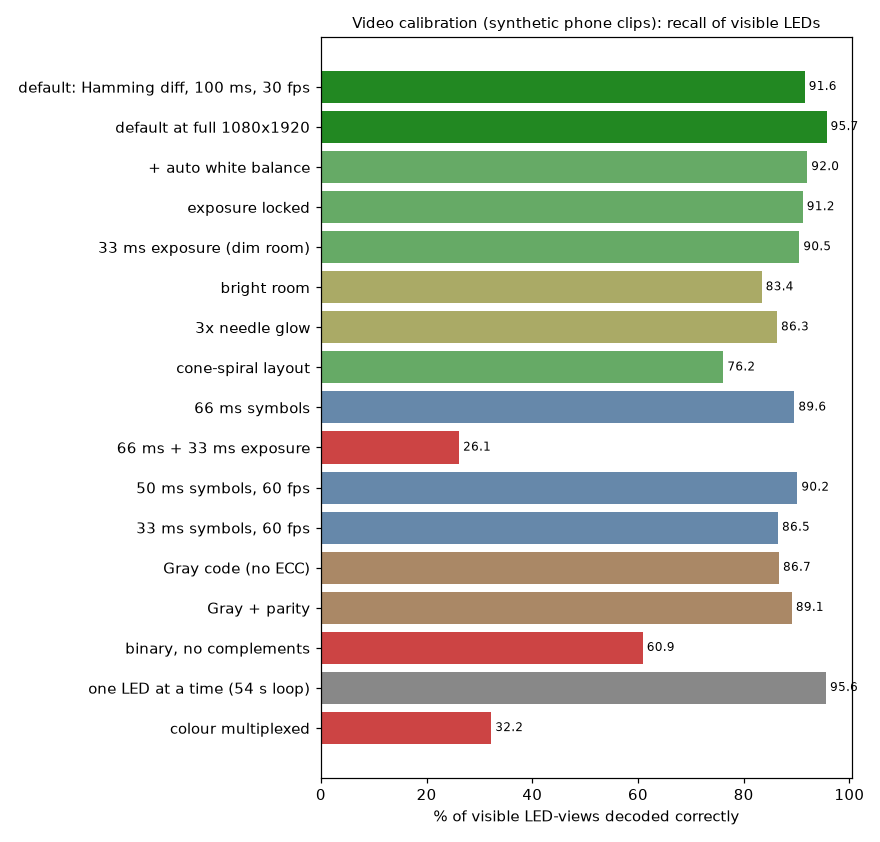

# Calibration findings

This is the report for the calibration workstream: what is wrong with today's coordinates, a ground-truth benchmark, better detection, video-based calibration, and what to do next. It goes with [the protocol](calibration-protocol.md) (for the firmware) and [the web design](calibration-web.md). Everything was validated offline: the tree was unavailable, so the work used the existing captures plus synthetic data with known truth. Every number below can be reproduced with the commands in section 8.

## Summary

- **The existing captures are index-scrambled, and today's coordinates can't be trusted LED by LED.** The capture loop raced the camera buffer:
  - every sequential frame `led_i.jpg` shows LED *i−1*;
  - frames sometimes repeat, so each view drifts by a different 5–21 LEDs by the top of the tree;
  - the binary capture is off by one bit.

  The views therefore disagree about which LED is which. A fundamental-matrix fit finds only about 10% consistent correspondences between any two real views, against 85% in a drift-free simulation. Two attempts to recover the mapping geometrically failed on a synthetic replica of the problem. **Recapture is needed.** `capture.py` is fixed (section 1.2).
- **On a synthetic replica of the real capture setup (lag 1, no light fittings), the current pipeline has a 12–14 cm median 3D error on a 1.75 m tree.** 329–368 of 500 LEDs are more than 10 cm out. The new pipeline (frame-differencing detector, correct lag, perspective bundle adjustment) gets **0.58 cm median, 0.91 cm p90, none over 10 cm.** Removing only the 1.78× x/z stretch (review H8) would help much less (10–12 cm). The main loss is the unregistered orthographic model.
- **Video calibration works in simulation.** The tree loops a 6.6 s sequence: a Barker-13 sync, then a 14-bit extended-Hamming code of the LED index, sent as pattern + complement frames at 100 ms per frame. Four phone clips of about 11 s decode **92% of visible LEDs (96% at full 1080×1920), with zero wrong IDs and a 0.7–0.9 cm median 3D error, none over 10 cm**, with no shared clock, auto exposure and white balance on, rolling shutter, and H.264. That's about 45 s of filming in total, against about 2.5 minutes **per angle** for the sequential stills.
- **The decoder finds its own timing.** It syncs on blinking-LED local contrast, which auto exposure can't disturb, then refines on pattern/complement transitions. That pins the loop phase to within a few ms and recovers the rolling-shutter readout.
- **Code choice matters.**
  - The differential extended-Hamming code is the most robust option.
  - Gray (9 bits) and Gray + parity decode 87–89% of visible LEDs, but with 15–24 swaps against 0.
  - Plain binary without complements reaches only 61%, with 43 LEDs over 10 cm.
  - 66 ms symbols work with short exposures (90%), but collapse to 26% when the phone exposes for 33 ms in a dim room. Keep 100 ms at 30 fps.
- **Colour multiplexing (3 bits per frame in R, G, B) is not worth pursuing.** In the phone model it recalls at most 41% of visible LEDs at half resolution (0.5% with 3× crosstalk), where 3D solving fails, and 68% at full resolution, with 70 swaps. Even if it worked, it would shorten the loop only from 6.6 s to 5.1 s. Each bit gets a third of the light, and colour comes from the video's chroma, which phones and H.264 store at quarter resolution and quantise coarsely. Mono differential is the default (section 5.3).
- **The firmware side is small.** The tree just plays host-built bitplane frames (`.tcal`) on absolute deadlines through the normal output stage, and the firmware thread has already implemented and tested this against the test vector. All pattern design lives on the host.

## 0. First real calibration (18 October 2026)

The first real run used five 1080×1920 portrait HEVC clips at 59 fps, 7.7–26 s long, filmed by turning the tree in front of a fixed phone. Two clips (clip1 and clip2) were taken at the same angle.

**Decoding.** Sync scores were 0.69–0.88, and each clip gave 192–244 confident detections. 453 of 500 LEDs were seen at least once.

**Bugs it exposed, now fixed:**

- **Decoding was too slow and memory-hungry for 60 fps phone video.** The coordinator's sequential run was killed after 30 minutes. Sync refinement recomputed every LED's exposure integral for each of 755 candidates, and the sync pass kept every downsampled frame in RAM (about 5 GB for the 26 s clip). Now the integrals are precomputed per exposure (identical results), only a float16 local-contrast stack is kept, and clips decode in parallel. One clip takes 31.5 s → 4.9 s; **all five decode in 26 s wall-clock**. Detections match the earlier ones to a median of 0.11–0.19 px. `--max-fps 30` and `--scale 0.5` exist for slower machines, but barely help on a fast one (HEVC decoding dominates), and `--scale 0.5` finds 12–18% fewer LEDs.
- **Bundle adjustment never estimated the focal length.** It always stayed at its initial guess: on synthetic data, the recovered focal was always exactly one of the guesses. The generic sparse solver converged too slowly along the focal/depth direction. It has been replaced with Levenberg–Marquardt with analytic Jacobians (`calib/ba.py`), estimating k1 only, since phone video is already distortion-corrected. Synthetic focal recovery: true 1285 px, recovered 1283 px from starting guesses of 1152, 1632 and 2304; it used to stay at the guess, with 0.6–7 cm 3D error depending on which guess was used. **Benchmark gains:** L0 still captures go from 0.58 cm to 0.45 cm median 3D error; the default video configuration from 0.82 cm to 0.63 cm at 540×960, and from 1.03 cm to 0.59 cm at full resolution.
- **The solve started from a degenerate pair.** It picked the pair with the most shared LEDs, clip1 + clip2 (222 shared, 1% median image shift), and then failed. Pairs are now ranked by overlap × parallax, a pair with under 3° triangulation angle is skipped, and a view is dropped only as a last resort, with a warning. `solve` warns about near-duplicate viewpoints.
- **Near-duplicate clips made the wire noisy.** LEDs seen only by the duplicate pair were triangulated from nearly parallel rays, giving 55 steps over twice the median. LEDs whose widest ray angle is under 3° are now treated as single-view and placed along their ray by the wire prior, which brings that down to 5.

**Result with all five clips:**

| Measure | Value |
|---|---|
| Median reprojection error | 0.65 px |
| Focal length | 1642 px (k1 −0.02) |
| LEDs per number of views (0–5) | 47 / 104 / 149 / 148 / 43 / 9 |
| Wire audit | 5 steps over 2× the median, 6 outliers |
| Height/width | 1.57 |
| Agreement with the 4-clip solve, similarity-aligned | median 0.002, p90 0.007 tree heights |

**Camera layout.** The solved camera azimuths are about 0°, 46°, 133° and −123° (clip1 and clip2 coincide). That corresponds to the tree being turned in front of a fixed phone, which is geometrically the same as walking around it.

## 1. What is wrong with the current coordinates

### 1.1 Audit of `coordinates/coords.csv`

`./calibrate.py quality coordinates/coords.csv --legacy --height-m 1.75 --pitch 0.10 --reference` undoes the legacy x/z stretch, rescales to a 1.75 m LED span, and compares with the synthetic truth layouts. Pitch is the assumed 10 cm wire spacing.

| Metric | Current coords | Synthetic truth (derived from them) |
|---|---|---|
| Consecutive LEDs more than 1.5 pitches apart (wire-continuity violations) | 48 | 0 |
| Consecutive LEDs more than 2 pitches apart | 11 | 0 |
| Largest step between consecutive LEDs | 38 cm | 10 cm |
| Exact duplicates | 1 (LEDs 0 and 1) | 0 |
| Outliers (more than 1.5 pitches from the midpoint of their neighbours) | 7 | 0 |
| Wire path length | 48 m | 35 m |
| Height / width (after undoing the stretch) | 1.70 | 1.58 |

Before undoing the stretch, height/width is 0.96: the committed tree is as wide as it is tall (review H8). In its own units, 73 steps exceed 1.5× the median step.

### 1.2 The capture loop raced the camera

`capture.py` set an LED over HTTP, slept 150 ms, discarded two frames and saved the third. The firmware only applies the request on its next 100 ms poll (`main.py:833`), and the webcam keeps buffering frames during the sleep. The evidence from the real captures:

- **Off by one.** `led_0000.jpg` contains no lit LED in all ten sequential sets: its peak residual is 7–34, against 100–250 in the other frames. LED 499 was never photographed.
- **Cross-check with the binary capture.** In frontnew, the bit frames were held for 500 ms. The sequential detections spell "LED *f−1* in frame *f*", with bit frame *k* showing pattern *k−1*: 87 of 364 frames match exactly. Every other (lag, bit-shift) hypothesis matches at most 6, and chance is about 1.4. So the binary capture is also off by one, which explains why it never decoded. LED 0 is never lit in that code anyway.
- **Contaminated backgrounds.** Six of the `background.jpg` frames still show the bit-3 pre-focus pattern lit.
- **Repeated frames.** Some consecutive frames are near-identical images: maximum difference 5–28, against a typical 160–230 between frames. Each repeat pushes every later frame one more LED behind.
- **Drift between views.** Smoothed per-view height curves, compared in windows, show the four tue views offset from each other by +5 to +21 LEDs in the upper half of the tree, growing along the string (left panel below). No single index shift makes two real views agree: the epipolar inlier fraction is flat at 10–20% for every shift (right panel). A synthetic scene without drift peaks sharply at the right shift (85%). A synthetic scene with 5% repeats and 2% skips per frame (dataset D) reproduces the real flat profile.



**Consequence.** Each view labels a different LED with the same index, so averaging views (as `multi_angle_triangulate` does) mixes LEDs that are up to 2 m apart along the wire. That is the 37–46 px scatter the review measured. Perspective bundle adjustment can't fit the real data either: the median reprojection error is 12–29 px, against 1.5–2 px on any synthetic set.

**Fixing `capture.py`.** It now reads frames continuously through the settle time, so the buffer never holds stale frames. The default settle is 250 ms, and `metadata.json` records `capture_version: 2`. The fix was checked against a simulated buffered webcam with firmware-poll and camera latency:

| | Wrong frames out of 40, settle 150 ms | settle 300 ms |
|---|---|---|
| Old: sleep, then discard 2 | 21 | 0 |
| New: read through | 0 | 0 |

It has **not** been tested on the real webcam and tree.

**Can the existing captures be rescued?** I tried two ways of recovering each view's frame-to-LED mapping:

1. Viterbi alignment against reprojections, growing along the wire from *f−1*.
2. DTW on height curves to seed that alignment.

On dataset D, where truth is known, both failed, at 28 cm and 41 cm median error. Every view drifts, including any reference, and a drift shared by all views is almost unobservable from geometry. The code is kept in `calib/align.py` as a starting point, and `detect` tracks the repeats it can see (`repeated_frames` in each detections file). I did not produce new coordinates from the real captures: they would not be better than the current ones in any way I could demonstrate.

### 1.3 Geometry (review H8–H10), quantified

The orthographic, unregistered 0/90/180/270° model is the larger error, even without lag or drift. On synthetic stills with correct indices (dataset A0), the current pipeline has a **12.3 cm** median error. Fixing only the anisotropic pixel normalisation gives **10.7 cm**. Perspective BA on the *same* `local_contrast` detections gives **0.64 cm**. A perspective solve also can't be mirrored, which settles the review's chirality question by construction.

## 2. Ground-truth benchmark

### 2.1 Layouts

`calib/layout.py` provides two ground-truth layouts.

- **`legacy-cleaned`** is a plausible truth derived from today's coordinates:
  1. undo the 1.78× stretch;
  2. scale to a 1.75 m LED span;
  3. smooth along the wire (σ = 1.5 LEDs) to remove detection jitter;
  4. add branch-scale in/out zigzag;
  5. relax so no consecutive pair is more than 10 cm apart.

  It keeps the real index-to-height correlation (0.77 against 0.76).
- **`cone-spiral`** is procedural, so that nothing overfits to one shape. Note that it's denser than the real string (median step 2.8 cm), which makes it a harder case for blob overlap.

### 2.2 Simulator

`calib/render.py` renders what a webcam or phone sees:

- **Cameras:** pinhole with k1/k2 distortion and principal-point offset, in handheld positions with ±12° yaw jitter, ±3° roll and varying heights and distances.
- **LEDs:** point sources with directional bullet-LED emission. The emitting spot is offset 4 mm from the LED centre, and partial cover by needles shifts the centroid.
- **Occlusion:** Beer–Lambert attenuation through a fitted foliage cone, a hard trunk, and random needle shading and occlusion.
- **Scattered light:** needle glow around each lit LED (visible even when the LED itself is hidden), light thrown onto the wall, room fill light proportional to total LED output, and static light fittings in shot.
- **Optics and sensor:** a two-component lens halo, camera colour crosstalk with warm white balance (which is why white LEDs look blue in the real frontnew captures), shot and read noise, saturation with charge bleed, and sRGB tone.
- **Camera control:** auto exposure with gain lag and wobble, optionally locked; optional grey-world auto white balance.
- **Video only:** rolling shutter (every row samples the scene at its own time, including far light), per-row exposure integration, tree/camera clock drift (40 ppm), timestamp jitter, and H.264 at crf 20 in 4:2:0.
- **Stills only:** the real capture bug, as a lag, repeat and skip schedule.



The figure shows LED-only residuals (frame minus a fitted per-pixel reference) from the 180new capture (top) and the simulator (bottom). Real captures aren't shown directly because they show a home interior. The simulator reproduces the dark exposure, saturation and diffuse needle glow. **Known gap:** real glow is sharper and more structured, with specular glints on needles, than the simulator's diffuse cloud, and real exposure and white-balance swings between frames are larger. On real data the detection confidence model is applied as fitted on synthetic data, so it may be overconfident there.

### 2.3 Datasets

These are the still datasets, each 4 webcam views × 500 LEDs at 608×1080, like the real captures.

| Dataset | Layout | Light fittings in shot | Capture lag |
|---|---|---|---|
| A | legacy-cleaned | 2 | none |
| A0 | legacy-cleaned | none | none |
| B | cone-spiral | 2 | none |
| L | legacy-cleaned | 2 | 1 |
| L0 | legacy-cleaned | none | 1 (the real situation) |
| D | legacy-cleaned | 2 | 1, plus 5% repeats and 2% skips |

The video datasets are 4 phone views at 540×960 (half of 1080×1920 resolution, for sweep speed; section 5.4 covers full resolution).

## 3. Detection

The detectors are in `calib/detect.py`. All the new ones work on linearised intensity, refine the peak to sub-pixel precision with a weighted centroid above half-maximum, and return a confidence or an explicit miss.

| Detector | Idea |
|---|---|
| `local_contrast` (current) | Brightest local-contrast blob; never reports a miss |
| `background` | Difference against `background.jpg` |
| `ref` | Subtract a gain- and offset-fitted reference: the per-pixel median of the frames themselves, which are almost all-off |
| `diff` | Subtract the gain-fitted mean of the previous and next frames |
| `ref_dog` | `ref`, then a difference-of-Gaussians band-pass to favour compact cores over glow |

Confidence is a logistic model on log SNR, compactness, second-peak ratio and saturation. It was fitted on A and evaluated on B and A0.

2D results over 4 views (2000 frames). "Correct" means within 4 px; "gross" means confidently reported but more than 10 px off.

| Detector | A recall / precision / gross | B recall / precision / gross | A0 recall / precision / gross |
|---|---|---|---|
| `local_contrast` | 0.09 / 0.05 / 1896 | 0.05 / 0.04 / 1924 | 0.94 / 0.77 / 327 |
| `background` | 0.71 / 0.71 / 203 | 0.73 / 0.71 / 214 | 0.70 / 0.71 / 178 |
| `ref` | 0.93 / 0.92 / 17 | 0.92 / 0.92 / 11 | 0.93 / 0.90 / 59 |
| `diff` | 0.92 / 0.93 / **3** | 0.89 / 0.92 / **2** | 0.93 / 0.93 / **15** |
| `ref_dog` | 0.93 / 0.91 / 47 | 0.92 / 0.91 / 40 | 0.93 / 0.91 / 48 |

- **`local_contrast` locks onto light fittings** (A and B). Without fittings it finds the LED but never reports a miss, so every hidden LED becomes a confident wrong position.
- **`background` suffers from exposure changes** between the background frame and the LED frames. In the real captures it's worse still, because the background frames show the pre-focus pattern.
- **Every good detector has a median error of about 2 px**, which is the simulator's emitter-position floor.
- **Band-pass filtering (`ref_dog`) didn't help**, because needle glints pass the band.
- **`diff` has the fewest gross errors** and is the default.

## 4. Still captures end to end

Median, p90 and maximum-quality figures are 3D errors after similarity alignment to truth, on a 1.75 m tree. The current pipeline gets reflection allowed in the alignment, as it can't determine chirality. "Swaps" counts LEDs whose position is closer to another true LED than to their own.

| Dataset | Pipeline | Median | p90 | Over 10 cm | Swaps |
|---|---|---|---|---|---|
| A0 | current (`analyze --validate` + `multi_angle`) | 12.27 cm | 20.14 | 340 | 407 |
| A0 | current, isotropic pixels only | 10.65 | 16.95 | 278 | 378 |
| A0 | `local_contrast` + perspective BA | 0.64 | 2.49 | 18 | 23 |
| A0 | **`diff` + perspective BA + wire prior** | **0.95** | **1.60** | **0** | **0** |
| A | current | fails (no output) | – | 500 | – |
| A | `diff` + BA | 2.40 | 3.88 | 0 | 4 |
| A | `ref` + BA | 0.96 | 1.60 | 0 | 0 |
| B | current | fails | – | 500 | – |
| B | `diff` + BA | 0.59 | 1.37 | 0 | 2 |
| L | current | 34.7 | 52.4 | 491 | 498 |
| L | `diff` + BA, lag assumed 0 | 5.65 | 9.24 | 30 | 301 |
| L | `diff` + BA, lag 1 | 0.74 | 1.23 | 0 | 0 |
| **L0** | **current, as run today** | **13.69** | 21.56 | 368 | 409 |
| L0 | current, with lag fixed | 11.86 | 19.13 | 329 | 393 |
| **L0** | **`diff` + BA + wire prior, lag 1** | **0.58** | **0.91** | **0** | **0** |
| L0 | `diff` + BA, no wire prior | 0.60 | 0.94 | 0 | 0 (1 LED unsolved) |







Notes:

- **When the current pipeline "fails"**, `local_contrast` has put most LEDs on the light fitting. `validate_wire_constraint` then marks them all as duplicates, and nothing is left to triangulate.
- **No detector wins everywhere.** `ref` beats `diff` on A, and `diff` beats `ref` on B. `diff` is the only one that never produced an LED over 10 cm. An ensemble (agree within 3 px, otherwise lower confidence) is a cheap next step.
- **The wire prior changes accuracy very little here,** because almost every LED is seen in at least two views. Its value is completeness: it places LEDs seen in one view on their ray, and interpolates LEDs seen in none, with low confidence.
- **The solver self-calibrates.** Focal length is recovered within 5–10% (the usual focal/depth trade-off, harmless for shape), plus k1/k2 and each view's pose, with no 0/90/180/270° assumption.

## 5. Video calibration

### 5.1 How it works

- **Sequence** (`calib/sequence.py`, layout in protocol §9):
  - 1 s all-off lead;
  - Barker-13 of all-on/all-off frames;
  - off and on references;
  - each code bit as pattern then complement;
  - Barker-13 tail.

  The default is the extended Hamming (14, 9) code over the Gray code of the index (minimum distance 4), 100 ms frames, a 6.6 s loop, 3.9 KB of `.tcal`. Every frame stays under the firmware's 47,812 power budget (1.5 A at 12 V, 8 mA per channel): code frames run at level 62, and all-on frames at 31. The benchmark rows below were rendered against the earlier 49,725 budget (levels 64 and 33); a re-run at the new levels is reported after the table.
- **Decoder** (`calib/video.py`):
  1. **Sync.** A per-band series of local contrast (light above the local level, relative to it) from the pixels that blink. This is invariant to auto exposure and static for light fittings. It's correlated with the plan's brightness to find the loop phase, then refined on frame-to-frame change energy, because every LED flips at each pattern→complement boundary. That fits phase, rolling-shutter readout and exposure. The brightness score breaks the symbol-period ambiguity.
  2. **Symbols.** Each symbol image is assembled row by row from the frames whose exposure for that row lies inside the symbol, averaged over loops.
  3. **Bits.** Soft bits per pixel are (pattern − complement), normalised by the pixel's own amplitude. Maximum-likelihood decoding correlates them with all 500 codewords, and the best-versus-second margin, relative to the code's distance, is the confidence.
  4. **Blobs.** Pixels are grouped per ID, the strongest connected component is kept, and its core gives the centroid. The detections then go to the same bundle adjustment as the stills.



### 5.2 Results

All runs use 4 phone views at 540×960 and 30 fps unless noted, with auto exposure on. The 2D recall is out of about 1067 visible LED-views.

Recall counts only LEDs that are actually visible in a view (transmission above 0.08), so it can't exceed 1. Earlier drafts divided every correct detection by visible LEDs, and full resolution "reached" 1.11. A wrong ID is a confident detection more than 10 px from its LED's true position. 3D figures are after similarity alignment, on a 1.75 m tree.

| Configuration | Recall of visible | Wrong IDs | 3D median | 3D p90 | Over 10 cm | Swaps |
|---|---|---|---|---|---|---|
| **Default: Hamming (14, 9) over Gray, differential, 100 ms** | **0.916** | **0** | **0.70 cm** | **1.69** | **0** | **0** |
| Default at full 1080×1920 | 0.957 | 0 | 0.92 | 1.61 | 0 | 0 |
| Default, another seed (camera poses and phase) | 0.901 | 0 | 0.99 | 2.28 | 1 | 8 |
| Default, cone-spiral layout (dense, 2.8 cm steps) | 0.762 | 0 | 0.72 | 1.40 | 0 | 0 |
| Default + auto white balance | 0.920 | 0 | 0.73 | 1.63 | 0 | 0 |
| Default, exposure locked | 0.912 | 0 | 0.98 | 2.15 | 0 | 1 |
| Default, 33 ms exposure (dim room) | 0.905 | 0 | 0.74 | 1.67 | 0 | 0 |
| Default, bright room (5× ambient) | 0.834 | 0 | 2.59 | 5.21 | 14 | 42 |
| Default, 3× needle glow | 0.863 | 0 | 1.62 | 4.24 | 8 | 35 |
| Default at one third of the LED level | 0.902 | 0 | 1.35 | 3.32 | 4 | 20 |
| Hamming, 66 ms symbols | 0.896 | 0 | 1.52 | 3.07 | 2 | 5 |
| Hamming, 66 ms, 33 ms exposure | 0.261 | 0 | 3.09 | 7.60 | 1 | 5 |
| Hamming, 50 ms symbols | 0.886 | 0 | 1.14 | 2.42 | 2 | 10 |
| Hamming, 50 ms, 60 fps | 0.902 | 0 | 1.76 | 3.30 | 4 | 10 |
| Hamming, 33 ms, 60 fps | 0.865 | 0 | 0.97 | 2.91 | 4 | 13 |
| Gray (9 bits, no error detection), differential | 0.867 | 0 | 1.42 | 3.80 | 4 | 24 |
| Gray + parity, differential | 0.891 | 0 | 2.24 | 4.04 | 2 | 15 |
| Binary, no complement frames | 0.609 | 1 | 2.23 | 9.15 | 43 | 99 |
| One LED at a time (54 s loop) | 0.956 | **179** | 1.59 | 3.44 | 32 | 34 |
| Colour: Hamming, 3 bits per frame, 100 ms | 0.322 | 0 | solve fails | – | – | – |
| Colour at full 1080×1920 | 0.684 | 0 | 2.11 | 6.59 | 20 | 70 |
| Colour, another seed | 0.336 | 0 | solve fails | – | – | – |
| Colour + auto white balance | 0.390 | 0 | solve fails | – | – | – |
| Colour, Gray code | 0.212 | 2 | solve fails | – | – | – |
| Colour, 66 ms | 0.260 | 0 | solve fails | – | – | – |
| Colour, 2× crosstalk | 0.094 | 0 | solve fails | – | – | – |
| Colour, 3× crosstalk | 0.005 | 0 | solve fails | – | – | – |
| Colour, 3× brighter LEDs | 0.406 | 0 | solve fails | – | – | – |
| Colour, 3× dimmer LEDs | 0.176 | 0 | solve fails | – | – | – |



**Re-run at the firmware's 47,812 budget** (levels 62 and 31 instead of 64 and 33; same seed, cameras and phase):

| Configuration | Budget | Recall of visible | Wrong IDs | 3D median | 3D p90 | Over 10 cm | Swaps |
|---|---|---|---|---|---|---|---|
| Default, 540×960 | 49,725 | 0.916 | 0 | 0.70 cm | 1.69 | 0 | 0 |
| Default, 540×960 | **47,812** | **0.916** | **0** | **0.82** | **1.72** | **0** | **0** |
| Default, 1080×1920 | 49,725 | 0.957 | 0 | 0.92 | 1.61 | 0 | 0 |
| Default, 1080×1920 | **47,812** | **0.959** | **0** | **1.03** | **1.94** | **0** | **0** |

Decoding is unchanged. The 0.1 cm shift in median is within the run-to-run variation noted below.

### 5.3 What the sweep says

- **The default is robust.** Auto white balance, locked or auto exposure, a 33 ms exposure, another camera arrangement and a different layout all stay at 0.7–1.0 cm median, with no wrong IDs. Recall misses are hidden or overlapping LEDs, which the wire prior fills in. The dense cone-spiral layout loses recall to overlapping blobs but keeps its accuracy.
- **A bright room hurts most** (0.83 recall, 2.6 cm), because the blinking LEDs have less contrast against the room. So does strong needle glow. Keep the room dim.
- **Symbol length versus exposure.** A row's sample is clean only if the symbol is at least one frame period plus the exposure, plus a guard. At 30 fps, 66 ms symbols are fine with short exposures but collapse once the phone uses 1/30 s, which phones do in dim rooms. 60 fps allows 33–50 ms symbols, but it costs light and the phone may not hold it in the dark. **100 ms at 30 fps is the safe default.** The loop is still only 6.6 s.
- **Codes.**
  - Complement frames are essential: binary without them gets 0.61 recall and 43 LEDs over 10 cm.
  - Error detection matters more than its cost of 5 extra bits. Gray alone has 24 swaps, against 0 for Hamming, because a single bit error in Gray is a valid neighbouring code.
  - Gray + parity is in between.
- **One LED at a time is the worst choice.** It has good recall but 179 wrong IDs: a frame whose LED is hidden still has a brightest spot, the same failure as the old stills. It's also 8× longer.
- **Is colour multiplexing worth pursuing? No, not now.**
  - **It doesn't work.** Every colour configuration loses badly. The best, full resolution, recalls 0.68 of visible LEDs with 20 LEDs over 10 cm and 70 swaps, against 0.96 and 0 / 0 for mono at the same resolution. At the benchmark's half resolution, colour can't be solved at all.
  - **The gain is small even if it worked.** The loop drops from 6.6 s to 5.1 s, because sync, references and training frames don't shrink. That's about 2.4 s per view at 1.6 loops, under 10 s for a whole calibration, on top of a capture that already takes under a minute of filming.
  - **The causes are physical** (section 5.5): a third of the light per bit, plus chroma subsampling and quantisation in phone video.
  - **What would change this:** a real-camera measurement showing at least 98% per-bit agreement after unmixing. Even then, the speed-up would be small. I'd spend effort on the walk-around single-clip flow instead (section 7).
- **The 3D median varies by about 0.3–0.6 cm between runs** of similar recall. That's the solver's robust-loss behaviour on different detection subsets; p90 and "over 10 cm" are the more stable indicators.

### 5.4 Capture time per calibration

| Method | Per angle | 4 angles |
|---|---|---|
| Sequential stills, old `capture.py` (500 × about 0.3 s) | about 2.5 min | about 10 min + moving the laptop |
| Sequential stills, fixed `capture.py` (250 ms settle) | about 3 min | about 12 min |
| Video, sequential one-LED code at 100 ms | 53 s loop, about 85 s filmed | about 6 min |
| **Video, default Hamming sequence** | **6.6 s loop, about 11 s filmed** | **under 1 min of filming** |

### 5.5 Colour multiplexing

- **The design.** Three bits per frame, one per channel, with complements and per-session R, G and B training frames. It cuts the code segment from 28 frames to 10, making the loop 5.1 s instead of 6.6 s.
- **The result.** At half resolution, recall is 0.5–41% in every colour configuration, including 3× brighter LEDs, auto white balance, and doubled or tripled crosstalk, and the 3D solve fails. At full resolution it's 68%, with 70 swaps.
- **Diagnosis.**
  - At the true LED pixels, 88–90% of colour bits have the right sign, against about 99% for mono.
  - Box-averaging colour over 3–5 px raises that to 94%. The 4:2:0 chroma of video stores colour at quarter resolution, which matters for 2–3 px LED cores.
  - A 14-bit word at 94% per bit is still wrong more often than not.
  - Making the LEDs 3× dimmer makes it worse (18%), and 3× brighter only slightly better (41%). Mono at a third of the level still decodes 90%. So the loss isn't photons alone: colour is recovered from the video's chroma, which phones and H.264 subsample and quantise more coarsely than luminance, and the red channel is weakest after a warm white balance (camera R ≈ 0.55 of B in the training matrix).
- **What the real captures say.**
  - At level 255, 33–75% of LED cores saturate (tue1 49%, frontnew 75%, 180new 37%, 270new 33%). Saturation destroys colour, so colour needs low levels, which the power cap already forces.
  - The white-balance tint varies by session: frontnew renders white LEDs blue (B share 0.46), while 180new and 270new are neutral. Per-session training frames are mandatory.
- **What a real test should measure before colour is revisited.** Film the default sequence's R/G/B training frames on the target phone and report:
  1. the 3×3 mixing matrix and its condition number;
  2. per-channel SNR at LED cores against a mono frame at the same power;
  3. bit agreement after unmixing.

  If per-bit agreement is above 98%, colour would give about a 1.3× shorter loop. It is not a 3× gain, because the sync, references and training frames don't shrink.

## 6. Recommendations

1. **Recalibrate with video** once the rewrite firmware is on the tree. Press the HA button "Play calibration sequence" (protocol §7), film 4–6 spots around the tree for about 11 s each, holding still, then run:

   ```
   ./calibrate.py decode-video view*.mp4 --out positions
   ./calibrate.py solve positions/view*_detections.json --out coordinates
   ```

   The first clip should be the "front".
2. **Or recapture stills** with the fixed `capture.py` (old firmware works too), then run:

   ```
   ./calibrate.py detect --lag 0
   ./calibrate.py solve ...
   ```

   Captures with `capture_version` 2 need lag 0; older ones need lag 1, and their drift can't be undone.
3. **Keep the room dim but not black.** In the sweep, a brightly lit room cost the most: 83% recall and 2.6 cm. Auto exposure and auto white balance cost little, so locking them is optional.
4. **Keep the default sequence** (mono Hamming, differential, 100 ms). 66 ms works only with short exposures. 60 fps with 50 ms symbols (90% recall) is an option if the phone holds 60 fps in low light.
5. **Coordinate frame.** `coords.txt` follows the agreed contract: y ∈ [0, 1] from the lowest to the highest LED, x and z in the same units, origin on the trunk axis, +x towards the first (front) view, right-handed.
   - `solve` also writes `coords_metres.csv`, with per-LED confidence, views and reprojection error. Metres assume `--height-m` (default 1.75), unless the user measures the LED span; a wire-pitch option would be better.
   - I'd suggest the effect context eventually carries `scale_m` (metres per unit) and per-LED confidence, so effects can de-emphasise interpolated LEDs. I have not changed the contract.
   - Until a recapture, effects should keep using the adapter over today's `coords_compact.txt`. I have not overwritten it.

## 7. Novel ideas

These are in [calibration-web.md](calibration-web.md) §6, with feasibility ratings. The most valuable, cheapest ones:

- **Walk-around single clip.** The tree loops; the decoder segments the still windows into views automatically. High feasibility.
- **Verification by playback.** After solving, play a plane sweep with the new coordinates and check it automatically on video. High feasibility.
- **Wire-order self-check.** Light the first and last 10 LEDs in distinct colours, to catch a reversed string or a dead pixel shifting the indices. High feasibility.

## 8. Reproducing

```bash
# Stills: render, then score detectors x triangulation in 3D
./calibrate.py simulate --out .scratch/synth/L0 --seed 3 --lag 1 --param fixtures=0
./calibrate.py bench-stills .scratch/synth/L0

# Video: render 4 phone clips of the default sequence, decode and score
./calibrate.py simulate-video --out .scratch/vid/h100 --scale 0.5 --seed 1
./calibrate.py bench-video .scratch/vid/h100

# Real captures: detect (lag 1 for existing captures) and audit
./calibrate.py detect --captures captures --views tue1,tue2,tue3,tue4 --lag 1
./calibrate.py quality coordinates/coords.csv --legacy --height-m 1.75 --pitch 0.10 --reference

# The sequence the firmware plays, and its test vectors
./calibrate.py sequence --out sequences/default.tcal
uv run --with pytest --with numpy --with scipy --with opencv-python pytest tests
```

Other datasets use the flags in the tables, for example `--colour`, `--symbol-ms 66`, `--fps 60`, `--param exposure_ms=33`, `--awb`, `--crosstalk 2`, `--layout cone-spiral` and `--sequential`.

## 9. Limitations

- **All accuracy numbers are synthetic.** The simulator was matched to the real captures by eye and a few statistics, not fitted. Its glow is smoother than real glow, so real detection will be somewhat worse. The first real video capture should be checked against reprojection error (the synthetic value is about 1.5–2 px) and the playback check.
- **Real video was never decoded.** The tree was offline, and there are no real phone clips of a calibration sequence. Phone behaviour (variable frame rate, HDR or "night mode" frame fusion, exposure up to 1/30 s) was approximated; frame fusion in particular would break the decoder.
- **Firmware timing was not tested on the Pico 2W** by me; the firmware thread reports unix-port measurements. The decoder tolerates several ms of latch jitter and 40 ppm of clock drift.
- **The confidence model was fitted on synthetic data.** It is used as-is on real data.
